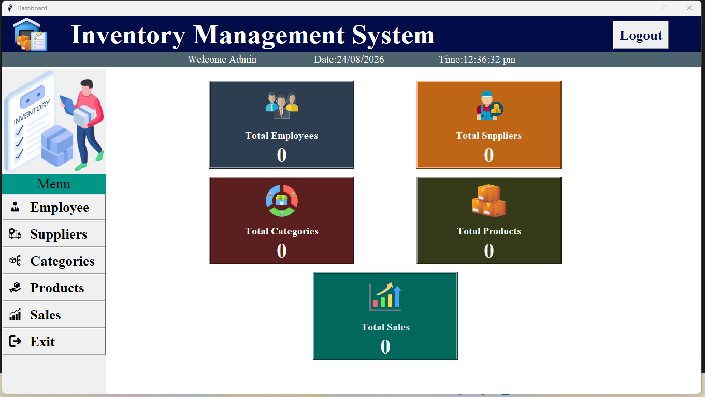

# Inventory Management System

## About the Project
The Inventory Management System is a desktop-based application developed using Python. It aims to simplify inventory-related operations and employee management through a graphical user interface.

This project is currently under development.

## Technologies Used
- Python
- Tkinter – Graphical User Interface (GUI)
- MySQL – Database
- PyMySQL – Python and MySQL connectivity

## Current Features
- Dashboard with navigation buttons
- Employee management interface
- Employee form for entering employee details

## Features in Progress
- Completing employee management operations
- Inventory and product management
- Database integration and validation
- Search and update functionality
- Testing and error handling

## Project Structure
- `dashboard.py` – Main dashboard
- `employee.py` – Employee management module
- Image files – Dashboard and interface assets

## Future Improvements
- Complete the remaining inventory management features
- Improve input validation and error handling
- Enhance database operations
- Explore analytics or AI/ML-based features where useful

## Screenshots

### Dashboard

### Employee Management

## Project Status
🚧 Work in Progress

## Author
Vaishnavi G K

## Note
This project is being developed as part of my learning journey in Python application development and database management.
